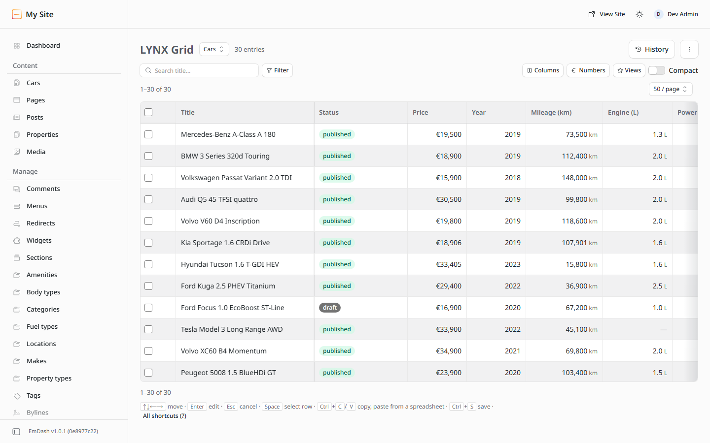
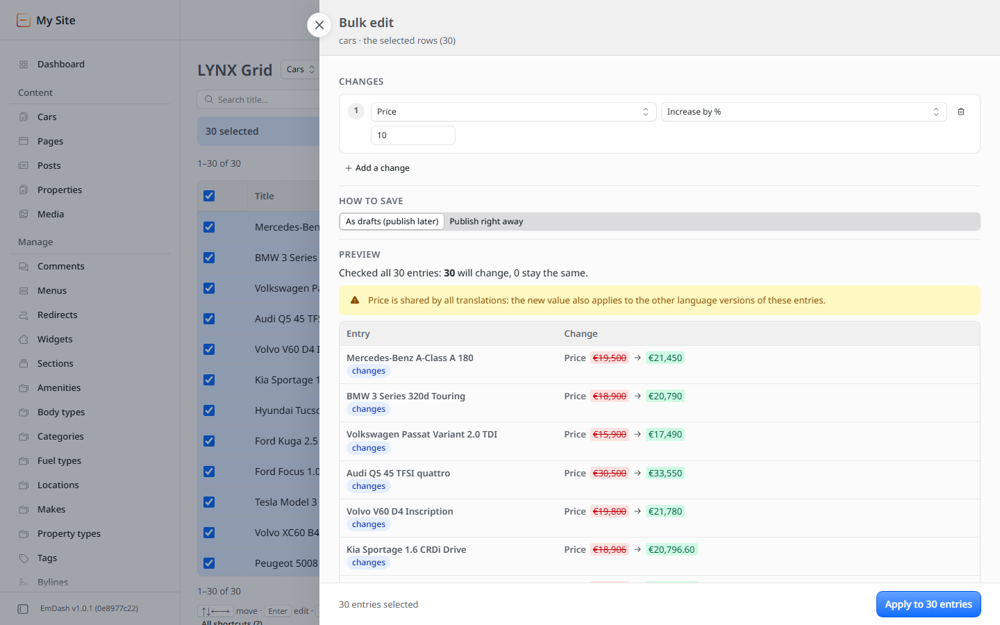
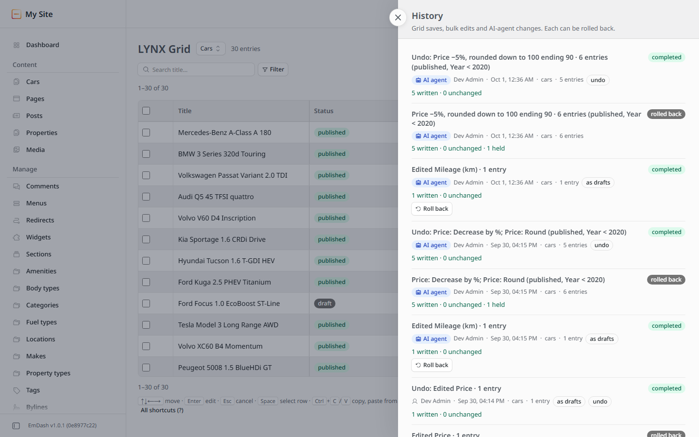

# LYNX user guide

LYNX is a content manager and bulk editor for EmDash 1.0 sites with structured catalogues (cars,
properties, products…). It has three parts:

| Part | Package | What it does |
|---|---|---|
| **LYNX** (core) | `lynx`, sandboxed plugin from the registry | Every change: bulk edits, single edits, new entries, trash and restore, the history of jobs and rollback. 17 AI-agent (MCP) tools. A small status page in the admin. |
| **LYNX Media** | `lynx-media`, sandboxed plugin from the registry | Imports images from web addresses into the media library (the only part with network access). One MCP tool. |
| **LYNX Grid** | `@realmag777/lynx-grid`, npm package (native plugin) | The spreadsheet page in the admin: edit in cells, filter, select, bulk edit with preview, history, saved views. |

Every change goes through the core, whoever makes it (you in the grid, an AI agent, a teammate),
so there is one history and every job can be rolled back.

---

## 1. Install

1. Install **LYNX** from the plugin registry (Admin → Plugins → Browse). Approve its capabilities:
   read the schema and content, write content, publish, restore from the trash, assign terms.
   It asks for no network access.
2. Optional: install **LYNX Media** the same way if you want images by URL (for agents and the grid).
3. Install the grid in your site project and add it to the EmDash configuration:

   ```bash
   npm install @realmag777/lynx-grid
   ```

   ```js
   // astro.config.mjs
   import emdash from "emdash/astro";
   import { lynxGrid } from "@realmag777/lynx-grid";

   export default defineConfig({
   	integrations: [emdash({ plugins: [lynxGrid()] /* …your options */ })],
   	// Required: lets the grid share the admin's copy of Kumo.
   	vite: { optimizeDeps: { include: ["@cloudflare/kumo", "@phosphor-icons/react"] } },
   });
   ```

   The grid's peer dependencies (`react`, `@cloudflare/kumo`, `@phosphor-icons/react`,
   `@emdash-cms/admin`) are the ones your EmDash admin already uses. The `optimizeDeps` line makes
   the grid use the admin's copy of Kumo; if your package manager still keeps several copies, also
   add them to `vite.resolve.dedupe`.

4. Open **Admin → LYNX Grid**. With no collections yet, choose **Install demo data** (cars or
   Spanish-coast real estate, with photos) to try everything on sample data.

The grid needs the core: without it the page says so. It reads content with read-only
capabilities (content, revisions, schema, taxonomies) and never writes content itself.

---

## 2. The grid



### Collections, columns and views
- Pick the collection at the top. The count next to it is the number of entries that match the
  search and the filter. On a big collection the exact number takes a few seconds; meanwhile the
  grid shows the number it counted last time, marked "≈" ("≈50,030 entries · counting…", pages
  "of ≈50,030"), and replaces it when the count is done.
- **Columns**: show or hide a column, pin it to the left (the title is pinned by default), drag a
  header edge to change the width (or focus the handle and use ← →), and use the small arrows on a
  header to move it. Click a header to sort; click again for the other direction; a third click
  goes back to "newest first".
- Column headers are never cut off: a column starts wide enough for its name, and the full name
  is also in the header's tooltip. When the table is wider than the screen, a shade at the right
  edge shows that more columns follow.
- **Numbers** sets how each number field is shown: a currency symbol before or after the amount
  (€, $, £, ¥, CHF, ₽, zł, or none) and the number of decimals. Price fields start as euros; litres
  show as "2.0 L". The setting is for everyone and applies to the table, the phone cards and the
  bulk-edit preview.
- **Compact** switches to shorter rows.
- **Views** saves the layout, sort, search and filter under a name (per user and collection) and
  brings it back later. **Reset layout** returns to the defaults. The layout is also remembered in
  the browser.
- Rows per page: 25, 50, 100 or 200; the page buttons are above and below the table.
- On a phone every row becomes a card; tap a value to edit it.

### Search and filter
- The search box looks in the title field.
- Click a header to sort. Only **indexed** fields sort, plus the dates, title, slug and status
  (EmDash keeps those in its own columns). A field without an index has no sort button: its header
  tooltip says to index it, and the gear ⚙ on the column does that. Empty values come last both
  ways.
- **Indexes.** The gear of a column (and **Settings** ⚙ next to History, tab **Basic**, section
  **Indexing**, for all fields at once) has **Index this field**: tick it and EmDash builds the
  database index while a bar moves (0.1–0.3 s on 10,000 cars), then the field shows **Indexed**
  and its header sorts; untick it to drop the index. Only administrators may change indexes
  (EmDash's schema permission); others see why the box is off. Each index takes a little space and
  makes saving a little slower. The presets index every field one sorts or filters by (price,
  year, mileage, engine, area, rooms…); for a site installed before that,
  tick them in Settings → Indexing. Text-like and number
  fields, dates, choices and yes/no can be indexed; rich text, lists, images and terms cannot.
- **Filter** combines conditions with AND: status (any, published, draft), field conditions that
  fit the field type (contains, starts with, =, ≠, greater/less than, between, is empty…) on
  indexed fields, and taxonomy conditions (has any of / all of / none of the chosen terms). The
  panel names the fields that could be filtered once indexed. **Clear filter** removes them.

### How the grid reads: the database does the work
EmDash gives plugins no entry count and no offset: `content.list` returns at most 100 entries
after a cursor (a draft for EmDash is in docs/upstream-issues.md, candidate 13). So for each
filter the grid reads the matching entries once, in the background, and keeps **only their ids and
the values of their indexed fields** — never whole entries, rich text, lists or images. It keeps
them in columns, once per collection: one list of ids and one list per indexed field (numbers and
dates as numbers, repeating text such as a colour as a short code); a filter keeps only the
positions of its entries in those lists, so ten filters do not hold ten copies. That is
what it needs for the total ("1–50 of 50,030"), for jumping to any page and for sorting and
filtering by indexed fields. The rows of a page (up to 100) are always read from the database by
id, whole, like a WordPress list page reads its LIMIT: a cell never shows an old value. The first
page shows before the count is complete; an indexed sort gives its first page from one database
query even before that.

The kept values live for up to a minute and must never outlive a change made past the grid:

- Any save, publish, unpublish, schedule, trash or restore, by anyone (the grid, an AI agent
  through MCP, the entry editor, another admin), fires EmDash's content hooks; LYNX Grid listens
  and drops what it keeps of that collection at once. On the demo an agent's new price shows in a
  sorted grid within a quarter of a second.
- Before reusing them the grid makes a cheap check: the newest change time of the collection
  (one small query), and for a taxonomy filter who carries those terms (EmDash answers that from
  its own cache). Assigning terms in the admin fires no hook and leaves the change time alone;
  this check catches it.
- An entry gone from a page (trashed elsewhere) drops them too.
- The **bulk-edit preview** always reads afresh; it never plans on kept values.

**Measured** on the demo with 50,030 cars (local SQLite, development server, medians of warm
runs; such a server varies by up to half): what the grid
keeps — ids and the values of 13 indexed fields, for the whole collection, a price range and a
make filter together — is about 7 MB (the heap freed when it is emptied, after garbage
collection; an object per entry and per filter took 41 MB). The first page shows in about 60 ms
with "≈50,030" (the last count), the exact total follows after about 4.5 s in the background; a
page at 10,000 takes 25–50 ms; a sort by price shows its first page in about 0.3 s, a sort by
another indexed field afterwards about 40 ms; the filter "price 20,000–30,000" shows its first
page in about 0.2 s and its count (9,401) after about 6 s; "make = BMW" about 1.1 s and 6 s. The
time to the total is EmDash reading every entry 100 at a time — what an entry count in the plugin
API would remove.

**On Cloudflare (Workers).** EmDash runs in many short-lived isolates, each with its own memory
(128 MB on Workers). What the grid keeps is per isolate: the first request for a filter in an
isolate reads the ids, later ones in the same isolate reuse them, and an isolate that is recycled
simply reads again. The content hooks run in the isolate that made the change, so only that isolate
drops its values at once; every other isolate notices on its next request through the cheap check
above (newest change time, term carriers). One case it cannot see cheaply: an entry trashed in
another isolate stays counted there until that entry's page is read (then the values are dropped)
or the minute is over — EmDash gives plugins no cheap count. The last known counts ("≈") are not
per isolate: they live in the plugin's KV storage (one small record per collection: the whole
collection and its 40 most recently counted filters), so a fresh isolate shows "≈" at once. The
create, trash and restore hooks move the count of the whole collection by one; every finished
count writes the exact number back.

### Editing cells
- Click a cell to make it active, click again (or press Enter) to edit. Text and numbers are typed
  in the cell; long text opens a larger box (Ctrl+Enter keeps it); choices, yes/no, multi-select
  options and taxonomy terms have their own pickers.
- **Dates** open a calendar (Calendar23): pick the day (click the month name to jump to another
  month or year), set the time below, then ✔. **Clear** empties an optional date. The system
  dates (Created, Updated, Published) are set by EmDash and cannot be edited.
- After **Save** the table stays where it is: saved values are shown in place and the rows keep
  their order until you change the page, the filter or the sort.
- Values are checked as you type them, with the same rules the core uses, the field's limits and
  pattern included: a wrong value keeps the editor open and says why ("Doors must be at most 6").
- **Sliders.** A number with a short range in its field rules opens a slider on double-click or
  Enter: whole numbers up to 30 apart (Doors 2–6, Seats 1–9), decimals up to 20 apart in steps of
  0.1 (Engine 0–10 L). Arrows move it, Enter or **Apply** sets it. Typing into the cell still opens
  the plain input.
- **One-term taxonomies.** EmDash lets an entry carry several terms of any taxonomy; LYNX can hold
  a taxonomy to one term per entry (a car has one make, one body type, one fuel, one location).
  Such a column is named in the singular (Make, not Makes) and its picker shows radio buttons: a
  pick applies at once, **Clear** removes the term. The core refuses two terms there, from the
  grid, a bulk edit or an AI agent alike. The demo presets set it for make, body type, fuel,
  location and property type (core route `taxonomy/single`, `{taxonomy, single}`).
- Changed cells turn yellow. Nothing is written until you press **Save** (or Ctrl+S) in the bar at
  the bottom; **Discard** drops the changes. **Save writes straight into the entry**, as a product
  edit does in WooCommerce: a published entry shows the change on the site at once, a draft entry
  stays a draft. Publishing and unpublishing is the **Status** column's job (and a bulk-edit
  operation), never a side effect of saving a value. The photo and rich-text panels and bulk edits
  save the same way.
- An entry that carries unpublished changes made in the EmDash entry editor is left alone (its
  status cell shows "draft changes"; changed cells have an orange corner whose tooltip tells what
  the site shows): saving there would publish someone's unfinished work. Publish or discard those
  changes in the entry editor first.
- A cell that could not be saved turns red; the save message gives the reason and hovering the
  cell repeats it (for example an entry that carries someone else's draft). The other changes are
  saved, the other cells of the same entry included.
- **Rich text** (Portable Text) opens the admin's own rich-text editor in a side panel, with its
  formatting; saving is one entry edit in the history.
- **Photos**: double-click an image cell (such as the cover) or a gallery cell to open the photo
  panel. Add photos from the computer, from the media library or, with LYNX Media installed, by
  web address; remove them; reorder a gallery by dragging or with the arrows (the first photo
  comes first on the site). **Save** writes the whole gallery at once as one entry edit, in the
  history and undoable. The media library in the panel searches by title, description and file
  name, shows 12 to 96 photos per page with numbered pages, and opens a card when you click a
  photo (in the library or in the field): there you set the photo's **Title** and
  **Description** (the media library's alt text and caption; both may stay empty) and add it.
  A photo uploaded from the panel is titled with its file name, so it can always be found by it.
  A photo goes into a gallery once: the library lists only photos that are not in the field yet
  (remove one and it is offered again). A gallery that already holds a photo twice says so, and
  **Remove duplicates** keeps one of each.
  Other lists of fields (repeaters that are not a plain photo list) stay
  read-only in the grid: open the entry (the arrow icon at the start of the row, or Alt+Enter).

### Copy and paste
- Ctrl+C copies the active cell, or the selected rows as tab-separated text.
- Ctrl+V pastes a block from Excel, Numbers or Google Sheets starting at the active cell. Every
  value is checked; the ones that do not fit are skipped and listed.

### Keyboard
Press **?** (or F1) in the grid for the full list. The main keys: arrows, Home/End, Page Up/Down,
Tab to move; Enter or F2 to edit; Esc to cancel; Space to select a row (Shift for a range) or flip
a yes/no cell; Delete to clear; Ctrl+S to save; Alt+Enter to open the entry.

---

## 3. Bulk edit



1. Tick rows (Shift-click for a range, or the header box for the page). To take every entry that
   matches the search and filter, choose **Select all N matching entries**.
2. **Bulk edit** opens the panel. Add one or more changes: pick the field and what to do with it.
   What each field offers depends on its type:

   | Field type | Changes |
   |---|---|
   | Text | set, clear, append, prepend, find and replace (regular expressions, match case, whole words), change case, trim spaces, make slug |
   | Number | set, clear, increase/decrease by an amount or a percentage, multiply, round (step, up/down/nearest, price ending such as .99), copy from another field (with a percentage) |
   | Yes/no | set, toggle |
   | Choice / multi-select | set, clear, add or remove options, replace one option with another |
   | Date | set, clear, shift by minutes … years |
   | Taxonomy | add terms (with their parents), remove terms, replace all terms |
   | Status | publish, unpublish, schedule, cancel a schedule |
   | Whole entry | duplicate (draft copies), move to the trash |

3. **Preview changes** works out before → after for every selected entry (the first 500 of a
   bigger selection), with numbers formatted like the table, and counts how many will change.
   Yellow notes are the ones that change the result (entries saved as drafts, entries held back
   because they carry a draft, values shared by all translations, conflicts); small grey notes
   below the table are for information (how to undo, how much the preview covers).
4. **Apply to N entries** starts the job. The progress bar follows it; **Stop after this step**
   stops it cleanly. When it is done, **Roll back** undoes it.

Bulk edits never take a filter directly: the selection is frozen when you preview, so the job
changes exactly the entries you saw counted.

---

## 4. History and rollback



**History** lists every job: grid saves, bulk edits, new entries, trash and restore, rollbacks,
and changes made by AI agents (marked with an **AI agent** chip, here and on the LYNX page of the
admin). Each reads in plain words, such as "Undo: Price −10%, rounded · 5 entries (published,
Year < 2020)", and shows who, when, how many entries and the result. **Roll back** restores the values from before the job. Entries that someone changed
after the job are left alone and listed, so a rollback never overwrites newer work. The panel
takes three quarters of the window (the whole screen on a phone) and shows the jobs in numbered
pages of 10, 20 or 50.

### Empty drafts after a rollback
Rolling back a job that was saved **as drafts** leaves drafts that hold exactly the published
values. They change nothing, but publish-mode edits skip entries with drafts. After such a
rollback the grid offers **Remove empty drafts (N)**; the same check is in the ⋯ menu as **Find
empty drafts**. Only drafts identical to the published version are removed.

---

## 5. AI agents (MCP)

EmDash has a built-in MCP server at `/_emdash/api/mcp`. LYNX adds its tools to it.

1. Admin → Plugins → LYNX → **Agent access**: review the tools and switch access on. Do the same
   for LYNX Media if you use it. (Any update of a plugin switches agent access off until you
   review and switch it on again; that is EmDash's rule.)
2. Create a token for the agent: Settings → API tokens, with the scope `mcp:tools:lynx` (and
   `mcp:tools:lynx-media`). The token acts with your role: an editor's token cannot do what an
   editor cannot.
3. Point your MCP client (Claude, ChatGPT, Cursor…) at `https://your-site/_emdash/api/mcp` with
   that token.

The agent follows one working order: **list_fields → find_entries → preview_bulk → apply_bulk →
job_status**, and **rollback_bulk** to undo. It must show you the count and the preview before it
applies anything, and it has to repeat the exact count to apply.

| Tool | What it is for |
|---|---|
| `lynx__capabilities` | Start of a session: version, limits, the working order |
| `lynx__describe_site` | Collections, fields, revisions, taxonomies |
| `lynx__list_fields` | Fields of a collection and what can be done with each |
| `lynx__list_terms` | Terms of a taxonomy |
| `lynx__find_entries` | Filter and freeze a selection |
| `lynx__get_entries` | Read entries of a selection |
| `lynx__preview_bulk` | Before → after, without writing |
| `lynx__apply_bulk` | Start a bulk job (needs the confirmed count) |
| `lynx__job_status` | Move a job forward, see its progress |
| `lynx__create_entries` | New entries from JSON rows (dry run first) |
| `lynx__update_entry` | Correct one entry |
| `lynx__list_history` | Recent jobs, including the grid's |
| `lynx__rollback_bulk` | Undo a job |
| `lynx__get_memory` / `lynx__set_memory` | Notes about this site the agent should remember |
| `lynx__cases` / `lynx__run_case` | Ready-made starting points (reprice older stock, find incomplete entries…) |
| `lynx-media__import_media` | Import images by URL, then set them through LYNX |

Agent changes appear in the grid's history like any other job and can be rolled back there.

---

## 6. Speed: sandbox or in-process (Node hosting)

A bulk job writes entry by entry through EmDash. How many entries one step writes depends on
where the LYNX core runs:

- **In the sandbox** (installed from the registry, or `sandboxed: [lynx]`) every host call goes
  through the sandbox bridge, and with the default **Job step size: Auto** a step makes at most 8
  host calls (Cloudflare's limit is 10), which is 2 published entries per step. This is true on
  Node hosts too: inside the sandbox LYNX cannot tell a Node host from Cloudflare.
- **With Job step size: Fast** (LYNX settings) a sandboxed step makes up to 200 host calls. Use it
  only on a Node host: on Cloudflare such a step fails.
- **In-process** (`plugins: [lynx]` instead of `sandboxed: [lynx]`) the core runs inside the
  site's own process: no bridge, large steps, and one `job_status` call keeps working for up to
  20 seconds.

Measured on 5,030 cars (price +1 %, publish mode, 80 % of the entries published; production
build, Node, SQLite on one machine, 2026-10-01):

| How LYNX runs | One caller (an AI agent's `job_status`) | The grid (4 parallel callers) |
|---|---|---|
| Sandbox, step size **Auto** (the default) | 76 s | 51 s |
| Sandbox, step size **Fast** (Node hosts only) | 44 s | 34 s |
| **In-process** | **35 s** | **34 s** |

In-process is the fastest: about 145 published entries per second, 2.2× the default sandbox for
an agent and 1.5× for the grid. Most of the rest is EmDash's own work per entry: a published entry
is written as a draft revision, published, and published once more to refresh cached pages
(about 6.7 ms); a draft is one write (about 2.6 ms, about 385 per second).

To run LYNX in-process on a Node host, install the core as a package and move it from
`sandboxed` to `plugins` (keep LYNX Media sandboxed, it is the part with network access):

```bash
npm install @realmag777/lynx
```

```js
// astro.config.mjs
import lynx from "@realmag777/lynx";
import lynxMedia from "@realmag777/lynx-media";
import { lynxGrid } from "@realmag777/lynx-grid";

emdash({
	plugins: [lynx, lynxGrid()], // the LYNX core in-process
	sandboxed: [lynxMedia],
});
```

Remove the registry copy of LYNX first (Admin → Plugins, without deleting its data): a plugin under `plugins` with the
same id as a sandboxed one hides it. The id, the storage, the history and the agent tools stay
the same, so nothing is lost. The trade-off: in-process code runs with the site's full rights
instead of the sandbox's isolation. If you prefer to keep the sandbox, set **Job step size:
Fast** in the LYNX settings instead. On Cloudflare LYNX always runs in the sandbox; keep
**Auto** (or **Safe**) there.

---

## 7. Limits

- A selection (and so a bulk job) holds up to 50,000 entries; narrow the filter for more.
- In the sandbox the core works in small steps by default (at most 8 host calls each, a safe
  margin under Cloudflare's limit). Big jobs take several steps; the grid and `job_status` move
  them on. Section 6 shows how to make the steps larger on a Node host.
- The grid shows up to 200 rows per page and reads them with its own read routes.
- New entries: up to 50 per `create_entries` call. Images by URL: up to 20 per call, 8 MB each,
  public addresses only.
- Rich text cannot be edited as plain text in a cell (formatting would be lost): use the side
  panel or bulk replace/append, which keep formatting.

## 8. Troubleshooting

| You see | Why and what to do |
|---|---|
| "LYNX core is not installed" on the grid page | Install and enable the LYNX plugin; the grid only writes through it. |
| A red cell "Not saved: this entry has unpublished changes made in the entry editor" | Saving would put those changes live too. Publish or discard them in the entry editor, or use **Remove empty drafts** if they are a leftover. |
| "Changed by someone else meanwhile" | Someone saved the entry after you loaded the page. Reload and redo that cell. |
| The agent sees no LYNX tools | Agent access is off (or was switched off by an update), or the token lacks `mcp:tools:lynx`. |
| Images by URL are not offered | LYNX Media is not installed or not enabled. |
| A yellow box on the grid page: "LYNX Grid does not match the admin's packages" | The site has a version of React, Kumo, the phosphor icons or `@emdash-cms/admin` outside the grid's range. The box lists each one and gives the exact `npm install …` command; run it in the site folder, then restart the dev server or rebuild. Only the grid page is affected. |
| A yellow box: "LYNX Grid got its own copy of the admin's packages" | Two copies of React or Kumo are loaded (common with linked or workspace packages). Add the `vite` setting shown in the box (`optimizeDeps.include` with Kumo), or run `npm dedupe`, then restart. |
| Messages from the grid do not pop up | Same cause as the line above (the admin's toast area is in the other Kumo copy); the grid still works and writes the messages to the browser console. |
